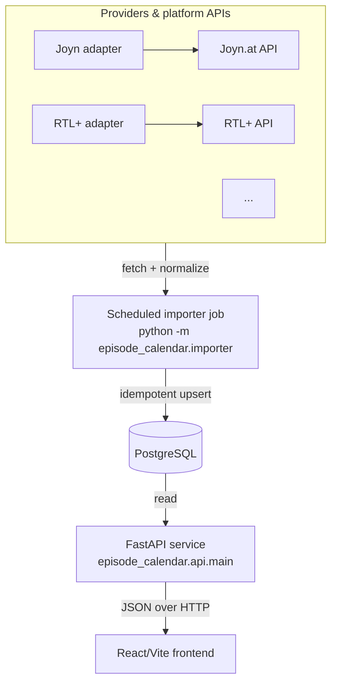

# episode-calendar

Episode Calendar is an open-source service for collecting, normalizing, and exposing TV episode
release dates from streaming providers.

## Architecture



Everything lives in the `src/episode_calendar` package, split into three components:

- `shared/` — the shared settings base, domain types, series configuration, and the async
  SQLAlchemy persistence layer used by both components.
- `api/` — the FastAPI read service (`episode_calendar.api.main:app`) with its routes in
  `api/routes.py` and its settings in `api/config.py`.
- `importer/` — the import job (`python -m episode_calendar.importer`), with the provider
  adapters under `importer/providers/`, the import logic in `importer/service.py`, and the
  provider/import settings in `importer/config.py`.

The domain model is `Provider -> Series -> Season -> Episode -> EpisodeRelease`; releases are
separate so an episode can have multiple streaming or broadcast releases. Provider IDs are
scoped by provider and imports use idempotent upserts.

Provider adapters implement the generic abstraction in `importer/providers/base.py`. Each
provider (Joyn Austria, RTL+, BBC iPlayer, Channel 4, ARD Mediathek, STV Player, Amazon Prime DE,
and Amazon Prime UK) is isolated in its own module. The importer fetches complete series trees,
normalizes them, and persists them. API requests read PostgreSQL and never call providers
directly. The shared adapter behavior and each provider's specialties are documented under
[`docs/providers/`](docs/providers/README.md).

## Development

### Prerequisites

Install or make available:

- **Git** — source control.
- **Python 3.13** — application runtime and tests.
- **uv** — Python dependencies and virtual environments.
- **Node.js 20+ and npm** — local frontend development and production builds.
- **Docker with Compose** — local PostgreSQL, containers, and image builds.
- **VS Code** (optional) — editor and integrated pytest runner.
- **Bruno** (optional) — manual REST/GraphQL requests.
- **curl and jq** (optional) — HTTP and JSON troubleshooting.
- **A modern browser with Developer Tools** — inspect public provider web-client configuration.

Cloud deployment additionally requires the **Google Cloud CLI (gcloud)**, **Terraform**, the
**Firebase CLI**, a Google Cloud project with billing, and a GitHub account for repository access. Homebrew is convenient for
installing command-line tools on macOS.

Never commit `.env`, provider keys, OAuth values, service-account keys, or Terraform state.

### Local Development

The common local flow, from a clean checkout:

1. Prepare the environment once:

   ```shell
   cp .env.example .env
   uv sync
   ```

2. Build and start PostgreSQL and the API container; migrations run on startup:

   ```shell
   docker compose up -d --build app
   ```

3. Import provider data (set provider credentials first, see
   [Provider configuration and import](#provider-configuration-and-import)):

   ```shell
   uv run python -m episode_calendar.importer all
   ```

4. Start the frontend in a second terminal:

   ```shell
   cd frontend
   npm install
   npm run dev
   ```

The API is available at <http://localhost:8000> (`GET /health` reports its status) and the
frontend at <http://localhost:5173>. The rest of this section covers the alternatives and
details.

#### Run the backend without Docker

Run PostgreSQL in Docker but the API on the host:

```shell
docker compose up -d db
uv run alembic upgrade head
uv run uvicorn episode_calendar.api.main:app --reload
```

#### Provider configuration and import

Maintain provider series in `config/series.json` (override with `SERIES_CONFIG_PATH`):

```json
{
  "platforms": [
    {
      "id": "joyn",
      "name": "Joyn.at",
      "series": [{"id": "villa-der-versuchung"}]
    },
    {
      "id": "bbc_iplayer",
      "name": "BBC iPlayer",
      "series": [{"id": "m002csng", "comment": "The Celebrity Traitors"}]
    },
    {
      "id": "ardmediathek",
      "name": "ARD Mediathek",
      "series": [{"id": "Y3JpZDovL2JyLmRlL2Jyb2FkY2FzdFNlcmllcy9GMjAyNVdPMDA4MjY1QTA"}]
    }
  ]
}
```

Each platform has an `id`, a display `name`, and a `series` list. Optional `run_import` and
`display` booleans default to `true` at platform and series level. The optional platform-level
`hasPrereleases` boolean (default `true`) declares whether the platform publishes early streaming
prereleases; when `false`, imported releases are never marked as previews. All series entries use
an `id` field. The optional `comment` field is only documentation for humans; it does not
configure or override the provider's series title.
For Joyn, open `joyn.at`, accept consent, open Developer Tools → Network, reload a series
page, select `api.joyn.de/graphql`, and copy its `x-api-key` header to `JOYN_API_KEY` in
`.env`. For RTL+, reload `plus.rtl.de`, accept the cookie banner, select the request to
`auth.rtl.de/.../protocol/openid-connect/token`, and copy the `client_secret` form value to
`RTLPLUS_OIDC_CLIENT_SECRET`. These are public web-client values, not user passwords. Never
copy or commit `Authorization`, `X-Bedrock-Token`, cookies, or other browser session data.

After setting the provider credentials and `config/series.json`, run the combined import once:

```shell
uv run python -m episode_calendar.importer all
```

BBC iPlayer uses public programme PIDs and does not require an additional secret. The example
configuration contains `m002csng` for *The Celebrity Traitors* and `b006m8dq` for *Strictly
Come Dancing*. Import only BBC data with:

```shell
uv run python -m episode_calendar.importer bbc_iplayer

# Channel 4
uv run python -m episode_calendar.importer channel4

# ARD Mediathek
uv run python -m episode_calendar.importer ardmediathek

```

Run it after PostgreSQL and migrations are ready, either before or while the API is running. The
API only shows episodes after the corresponding provider import has completed. Imports run in
parallel, are retried with backoff, and are idempotent, so the command is safe to repeat. A
failure is isolated to its provider or series; the overall command still exits unsuccessfully
if any import failed.

Useful API requests:

```http
GET http://localhost:8000/api/v1/series
GET http://localhost:8000/api/v1/series/{id}
GET http://localhost:8000/api/v1/platforms
GET http://localhost:8000/api/v1/episodes?from=2026-09-06T00:00:00Z&to=2026-09-13T23:59:59Z
GET http://localhost:8000/api/v1/episodes/last-week?timezone=Europe/Vienna
GET http://localhost:8000/api/v1/episodes/current-week?timezone=Europe/Vienna
GET http://localhost:8000/api/v1/episodes/next-week?platform=rtlplus
GET http://localhost:8000/api/v1/episodes/after-next-week?platform=rtlplus
```

Episode results are ordered by release time. `from`, `to`, `series`, `platform`, `timezone`,
`includeReruns`, `includePreviews`, and `includeReleaseHistory` are optional filters. Reruns are
excluded by default; `includePreviews=all` includes previews for every platform. A comma-separated
platform list such as `includePreviews=joyn,rtlplus` includes previews only for those platforms;
`includePreviews=false` excludes them everywhere. By default, only the newest matching release
per episode is returned. Set `includeReleaseHistory=true` to return all matching releases for each
episode. Week endpoints use Monday-to-Sunday weeks in `Europe/Vienna`
by default. The series `{id}` is the internal database UUID. The same requests can be made from
Bruno.

#### Frontend

In a second terminal, install dependencies and start the responsive React/Vite frontend:

```shell
cd frontend
npm install
npm run dev
```

Open <http://localhost:5173>. The local API is used by default. If the API runs elsewhere, set
`VITE_API_BASE_URL`, for example:

```shell
VITE_API_BASE_URL=http://localhost:8000 npm run dev
```

Create and preview a production frontend build with:

```shell
npm run build
npm run preview
```

Build the backend image locally from the repository root with:

```shell
docker build -t episode-calendar:local .
```

Filter selections and the most recently loaded series/episode data are kept in the browser's local
storage, so returning to the app renders immediately while fresh data is fetched in the background.
No account or installation is required.

Every episode in the calendar has a `gesehen` checkbox that tracks which episodes you already
watched. Marked episodes are dimmed so the remaining ones stand out, and the markers are stored in
the browser's local storage as well. Unchecking a marker restores the normal episode appearance.

The calendar renders one tile per episode. When a platform publishes several episodes at the same
instant – a full-season drop, a double episode, or an RTL+ prerelease of the whole season – each of
them appears as its own tile on that day: the release date belongs to the episode, and every tile
keeps its own `gesehen` marker, link, and `Vorab` badge.

#### Optional login and cross-device settings

The **Anmelden** button in the filter bar enables an optional, passwordless account. The backend
sends one email containing a six-digit code and a magic link; either one signs the user in, on any
device. A signed-in account stores filters, preview preferences, and seen episodes centrally, so
they follow the account between browsers. Without an account the app keeps all of that in local
storage and never calls the login endpoints.

Login mail is delivered through [Brevo](https://www.brevo.com) and needs no domain of your own: the
sender address is verified once by clicking a link Brevo mails to it. Set `BREVO_API_KEY`,
`AUTH_EMAIL_FROM`, and `AUTH_LINK_BASE_URL` in `.env` (see `.env.example`). Without an API key the
code and link are written to the API log instead of being sent, so local development needs no mail
account. Brevo's free tier covers ordinary login traffic; exceeding it only disables new login
emails, not anonymous use. See [docs/auth.md](docs/auth.md) for the endpoints, data model, security
decisions, and deployment setup.

### Tests and checks

Tests use an isolated SQLite database and never contact streaming providers:

```shell
uv run pytest
uv run ruff check .
uv run ruff format --check .
cd frontend
npm ci
npm test
npm run build
```

## Cloud Environment

Cloud deployment uses Cloud Run, Cloud SQL, Secret Manager, Artifact Registry, Cloud Scheduler,
Firebase Hosting, and Terraform. Review billing and quotas before continuing. Use short-lived
GitHub OIDC credentials for CI rather than service-account key files.

### Deployment overview

A first deployment on an empty Google Cloud project runs through the steps below. Each step is
self-contained, and each assumes the previous ones succeeded. Steps 1 and 2 need no Google Cloud
resource at all, so login mail can be validated before anything is billed.

| # | Step | Outcome |
| --- | --- | --- |
| 1 | [Set up the Brevo login sender](#step-1--set-up-the-login-mail-sender-at-brevo) | A verified sender address and API key, no domain needed |
| 2 | [Check the login flow locally](#step-2--check-the-login-flow-locally) | Real login mail arrives in a mailbox |
| 3 | [Prepare project and toolchain](#step-3--prepare-the-project-and-toolchain) | Project with billing, APIs enabled, image repository |
| 4 | [Bootstrap](#step-4--bootstrap-terraform-state-and-the-ci-identity) | Terraform state bucket and GitHub OIDC identity |
| 5 | [Apply the infrastructure](#step-5--apply-the-infrastructure) | Cloud SQL, service accounts, empty secret containers |
| 6 | [Store the secrets](#step-6--store-the-secrets) | `DATABASE_URL`, provider keys, `BREVO_API_KEY` |
| 7 | [Deploy the API](#step-7--deploy-the-api) | Cloud Run service, schema, first import |
| 8 | [Deploy the frontend](#step-8--deploy-the-frontend) | Firebase Hosting site and CORS |
| 9 | [Schedule the import](#step-9--schedule-the-periodic-import) | Two-hourly provider refresh |
| 10 | [Verify](#step-10--verify-the-first-deployment) | Health, API, and login on the public origin |

Automated deployments through GitHub Actions are optional and come last; see
[GitHub Actions deployment](#github-actions-deployment). The manual sequence below does not depend
on it.

Commands use `PROJECT_ID` as a placeholder. The Firebase Hosting steps spell out the example project
`episode-calendar-67234`; substitute your own project ID wherever it appears.

### Step 1 — Set up the login mail sender at Brevo

Login mail has to arrive without owning a domain. Brevo verifies a sender *address* by mailing a
confirmation link to it, so any mailbox you control is enough. This is a one-time setup:

1. Create a free [Brevo](https://www.brevo.com) account. The free plan sends 300 emails per day and
   needs no credit card.
2. Add the sender under **Senders, Domains & Dedicated IPs → Senders** (older dashboards call this
   **Senders & IP**) with the display name `Episode Calendar` and an address you can read. Brevo
   mails a confirmation link to that address; open it. Until that link is clicked, the API rejects
   the sender with `400`.
3. Optional: authenticate a domain in the same menu once you own one. That improves deliverability
   but is not required for sending.
4. Create an API key under **SMTP & API → API Keys** and copy it immediately; Brevo shows it only
   once.
5. Keep both values for the next steps:
   - `BREVO_API_KEY` — the API key.
   - `AUTH_EMAIL_FROM` — `Episode Calendar <the verified address>`, for example
     `Episode Calendar <login@example.com>`.

Because the `From` domain is not authenticated, some mailbox providers file these mails as spam. The
login code is part of the subject line, so it stays readable in a spam folder preview. The API call
and its failure handling are described in [docs/auth.md](docs/auth.md#email-delivery-with-brevo).

### Step 2 — Check the login flow locally

Validate delivery before creating any cloud resource.

1. Prepare the environment (details in [Local Development](#local-development)):

   ```shell
   cp .env.example .env
   uv sync
   ```

2. Put the values from step 1 into `.env`:

   ```
   BREVO_API_KEY=<Brevo API key>
   AUTH_EMAIL_FROM=Episode Calendar <verified-sender@example.com>
   AUTH_LINK_BASE_URL=http://localhost:5173
   ```

3. Start PostgreSQL and the API, then import provider data if you have the credentials from
   [Provider configuration and import](#provider-configuration-and-import). The login flow works
   without imported data, so this step can be skipped when only mail delivery is being tested:

   ```shell
   docker compose up -d --build app
   uv run python -m episode_calendar.importer all
   ```

4. Start the frontend in a second terminal and open <http://localhost:5173>:

   ```shell
   cd frontend
   npm install
   npm run dev
   ```

5. Click **Anmelden**, request a code, and confirm the mail arrives (check the spam folder). Type the
   code, then open the app in a second browser and sign in with the same address. Filters, preview
   preferences, and seen markers must follow the account.

Without `BREVO_API_KEY`, the code and magic link are written to the API log instead, so the flow can
also be exercised without a mail account:

```shell
docker compose logs -f app
```

### Step 3 — Prepare the project and toolchain

Install **Terraform** and the **Firebase CLI** in addition to `gcloud` (see
[Prerequisites](#prerequisites)).

1. Install and authenticate the [Google Cloud CLI](https://cloud.google.com/sdk/docs/initialize):

   ```shell
   gcloud init
   gcloud auth application-default login
   ```

2. Create or select a globally unique project and link an open billing account:

   ```shell
   gcloud projects create PROJECT_ID --name="Episode Calendar" --set-as-default
   gcloud billing accounts list
   gcloud billing projects link PROJECT_ID --billing-account=BILLING_ACCOUNT_ID
   gcloud config set project PROJECT_ID
   gcloud auth application-default set-quota-project PROJECT_ID
   ```

   If service activation reports that billing is not open, activate or create an open billing
   account first. Project IDs are permanent; do not use credentials or API keys as the ID.

3. Enable APIs and create the Artifact Registry repository:

   ```shell
   gcloud services enable run.googleapis.com sqladmin.googleapis.com artifactregistry.googleapis.com secretmanager.googleapis.com cloudscheduler.googleapis.com iam.googleapis.com
   gcloud artifacts repositories create episode-calendar --repository-format=docker --location=europe-west3 --description="episode-calendar images"
   ```

   If the repository already exists, keep it and continue. Authenticate Docker once per machine:

   ```shell
   gcloud auth configure-docker europe-west3-docker.pkg.dev
   ```

4. Verify the selected identity and project:

   ```shell
   gcloud config get-value project
   gcloud auth list
   gcloud auth application-default print-access-token >/dev/null && echo "ADC ready"
   ```

### Step 4 — Bootstrap Terraform state and the CI identity

Terraform keeps its state in a versioned Cloud Storage bucket, and the GitHub workflows
authenticate through Workload Identity. Both are created once by a script that runs with your own
`gcloud` identity, which therefore needs permission to create service accounts, Workload Identity
providers, buckets, and project IAM bindings.

```shell
gcloud auth login
gcloud auth application-default login
./scripts/bootstrap-cloud.sh \
  --project PROJECT_ID \
  --repository OWNER/episode-calendar
```

The default state bucket name is `PROJECT_ID-tfstate` (override with `--state-bucket`), and the
script prints `GCP_WORKLOAD_IDENTITY_PROVIDER` and `GCP_DEPLOY_SERVICE_ACCOUNT` for the GitHub
secrets described in [GitHub Actions deployment](#github-actions-deployment). It also grants the
deploy service account its project roles through a targeted Terraform apply. The script is safe to
repeat.

### Step 5 — Apply the infrastructure

The first Terraform apply creates Cloud SQL, the runtime and deploy service accounts, service
enablement, and empty Secret Manager containers. Copy the example variables, generate a database
password, and put it only in the ignored local tfvars file:

```shell
cp infra/terraform.tfvars.example infra/terraform.tfvars
openssl rand -hex 24
```

Copy the generated value into `database_password` in `infra/terraform.tfvars`, set `project_id`, and
keep `image` on the tag you will build in [step 7](#step-7--deploy-the-api). Keep
`deploy_cloud_run = false` and `enable_import_schedule = false` for this apply. The password is
sensitive but still exists in local Terraform state.

```shell
terraform -chdir=infra init -backend-config="bucket=PROJECT_ID-tfstate"
terraform -chdir=infra plan
terraform -chdir=infra apply
```

The Cloud SQL configuration explicitly uses the `ENTERPRISE` edition because `db-f1-micro` is
not available in `ENTERPRISE_PLUS`. If an apply fails part-way through, fix the issue and run
the same apply again.

### Step 6 — Store the secrets

The Terraform apply created empty secrets. Add their first versions now; use the same database
password and the provider values discovered during local setup. The `BREVO_API_KEY` is the key from
[step 1](#step-1--set-up-the-login-mail-sender-at-brevo).

```shell
CONNECTION_NAME="$(terraform -chdir=infra output -raw sql_connection_name)"
read -r -s DB_PASSWORD; echo
printf 'postgresql+asyncpg://episode_calendar:%s@/episode_calendar?host=/cloudsql/%s\n' "$DB_PASSWORD" "$CONNECTION_NAME" | gcloud secrets versions add episode-calendar-database-url --data-file=-
read -r -s JOYN_API_KEY; echo
printf '%s' "$JOYN_API_KEY" | gcloud secrets versions add episode-calendar-joyn-api-key --data-file=-
read -r -s RTLPLUS_CLIENT_SECRET; echo
printf '%s' "$RTLPLUS_CLIENT_SECRET" | gcloud secrets versions add episode-calendar-rtlplus-client-secret --data-file=-
read -r -s BREVO_API_KEY; echo
printf '%s' "$BREVO_API_KEY" | gcloud secrets versions add episode-calendar-brevo-api-key --data-file=-
unset DB_PASSWORD JOYN_API_KEY RTLPLUS_CLIENT_SECRET BREVO_API_KEY CONNECTION_NAME
```

Every version must exist before the Cloud Run service is applied, because the service references the
secret's `latest` version; without a version the revision cannot start. Without the environment
variable (for example in local runs) login emails are logged instead of sent. Terraform names the
mail secret through `brevo_api_key_secret` (default `episode-calendar-brevo-api-key`); changing that
variable later creates a new, empty secret, so decide the name before the first apply.

### Step 7 — Deploy the API

The Cloud Run service is applied by Terraform. The schema and the first provider import are separate
Cloud Run jobs, because the application container deliberately does not run migrations on startup.

Build and push an amd64 image. Apple Silicon users must specify the platform; use an immutable
tag or digest when possible:

```shell
docker build --platform linux/amd64 --provenance=false -t europe-west3-docker.pkg.dev/PROJECT_ID/episode-calendar/app:TAG . && docker push europe-west3-docker.pkg.dev/PROJECT_ID/episode-calendar/app:TAG
```

Set that image reference in `infra/terraform.tfvars`, set `deploy_cloud_run = true`, and apply:

```shell
terraform -chdir=infra plan
terraform -chdir=infra apply
```

The output contains `service_url`. Deploy and execute the migration job:

```shell
gcloud run jobs deploy episode-calendar-migrate --image=europe-west3-docker.pkg.dev/PROJECT_ID/episode-calendar/app:TAG --region=europe-west3 --project=PROJECT_ID --service-account=episode-calendar-runtime@PROJECT_ID.iam.gserviceaccount.com --set-cloudsql-instances=PROJECT_ID:europe-west3:episode-calendar-postgres --set-secrets=DATABASE_URL=episode-calendar-database-url:latest --command=uv --args=run,--no-sync,alembic,upgrade,head
gcloud run jobs execute episode-calendar-migrate --region=europe-west3 --project=PROJECT_ID --wait
```

Deploy and execute the provider import job:

```shell
gcloud run jobs deploy episode-calendar-import --image=europe-west3-docker.pkg.dev/PROJECT_ID/episode-calendar/app:TAG --region=europe-west3 --project=PROJECT_ID --service-account=episode-calendar-runtime@PROJECT_ID.iam.gserviceaccount.com --set-cloudsql-instances=PROJECT_ID:europe-west3:episode-calendar-postgres --set-secrets=DATABASE_URL=episode-calendar-database-url:latest,JOYN_API_KEY=episode-calendar-joyn-api-key:latest,RTLPLUS_OIDC_CLIENT_SECRET=episode-calendar-rtlplus-client-secret:latest --command=uv --args=run,--no-sync,python,-m,episode_calendar.importer,all
gcloud run jobs execute episode-calendar-import --region=europe-west3 --project=PROJECT_ID --wait
```

### Step 8 — Deploy the frontend

Firebase Hosting serves the static Vite build from the existing Google Cloud project. Install and
authenticate the Firebase CLI once:

```shell
npm install --global firebase-tools
firebase login
gcloud services enable firebase.googleapis.com --project=episode-calendar-67234
firebase projects:addfirebase
firebase use episode-calendar-67234
firebase hosting:sites:create episode-calendar-67234 --project=episode-calendar-67234
```

When `firebase projects:addfirebase` prompts for a project, select `episode-calendar-67234`. Before
running it, open the project once in the Firebase console and accept the Firebase Terms if prompted;
this acceptance cannot be completed by the CLI. Adding Firebase is a one-time,
irreversible project-level operation. The default Hosting site is normally provisioned as part of
this step; if it is not, run `firebase hosting:sites:create` afterwards. If site creation still
returns HTTP 403, the signed-in account needs the **Firebase Hosting Admin** role (or Firebase
Develop Admin) under **IAM & Admin → IAM**.

Build the frontend with the deployed API URL and publish it:

```shell
cd frontend
VITE_API_BASE_URL="$(terraform -chdir=../infra output -raw service_url)" npm run build
cd ..
firebase deploy --only hosting
```

The frontend is then available at `https://episode-calendar-67234.web.app`. Add that origin to
`cors_origins` in `infra/terraform.tfvars` (alongside the local origins) and apply Terraform so
the Cloud Run API accepts browser requests from Firebase Hosting:

```shell
terraform -chdir=infra apply
```

Verify that the deployed API returns a CORS header before opening the frontend:

```shell
curl -i -H "Origin: https://episode-calendar-67234.web.app" "$(terraform -chdir=infra output -raw service_url)/api/v1/series"
```

The response must contain `access-control-allow-origin: https://episode-calendar-67234.web.app`.

If the header is missing, inspect the active Cloud Run revision and its environment:

```shell
gcloud run services describe episode-calendar --region=europe-west3 --project=episode-calendar-67234 --format='yaml(status.latestReadyRevisionName,spec.template.containers[0].image,spec.template.containers[0].env)'
```

### Step 9 — Schedule the periodic import

The public site is functional at this point; the last resource is the recurring import. Set
`enable_import_schedule = true` and apply Terraform once more. The default schedule is
`0 /2 * * *` in `Europe/Vienna`; it invokes the existing import job with a dedicated service
account:

```shell
terraform -chdir=infra apply
gcloud scheduler jobs list --location=europe-west3
gcloud scheduler jobs run episode-calendar-import-periodic --location=europe-west3
```

Cloud Scheduler currently provides three jobs per billing account per month at no charge; one
periodic scheduler job is within that allowance. Cloud Run job execution and Cloud SQL runtime are
separate usage considerations. See the [official Scheduler pricing](https://cloud.google.com/scheduler/pricing).

### Step 10 — Verify the first deployment

Check the API and the public site:

```shell
curl "$(terraform -chdir=infra output -raw service_url)/health"
curl "$(terraform -chdir=infra output -raw service_url)/api/v1/series"
```

Then open the Firebase Hosting URL, request a login code, and confirm that a real mail arrives and
that the code signs you in. If login mail fails, the API answers `502`:

```shell
gcloud logging read 'resource.type="cloud_run_revision" AND resource.labels.service_name="episode-calendar" AND severity>=ERROR' --limit=50 --project=episode-calendar-67234 --format='value(timestamp,textPayload)'
```

The log line names the reason: a missing `BREVO_API_KEY` secret version, an unverified sender
(`400`), or an exceeded free-plan quota (`429`). Anonymous use is unaffected by all of them.

### GitHub Actions deployment

The repository contains two workflows. Both are optional; the manual sequence above produced a
working deployment without them.

- `.github/workflows/ci.yml` runs on pull requests, tests the Python application, builds the backend
  image, and builds the frontend.
- `.github/workflows/deploy.yml` runs on pushes to `main`, pushes an immutable backend image, applies
  Terraform and migrations, and deploys Firebase Hosting. Provider data is refreshed by the scheduled
  Cloud Run import job.

Add these repository secrets under **Settings → Secrets and variables → Actions**:

- `GCP_WORKLOAD_IDENTITY_PROVIDER` — printed by the bootstrap script in
  [step 4](#step-4--bootstrap-terraform-state-and-the-ci-identity).
- `GCP_DEPLOY_SERVICE_ACCOUNT` — printed by the same script.
- `DATABASE_PASSWORD` — the Cloud SQL application-user password from
  [step 5](#step-5--apply-the-infrastructure).

The provider API keys and `BREVO_API_KEY` stay in Secret Manager, so the workflow needs no extra
secrets for them. Ensure all four secret versions exist before the first workflow run, because the
Cloud Run service references each `latest` version. Do not create or upload a JSON key.

### Deploy an update

After changing application code, `config/series.json`, or API behavior:

1. Run local tests and checks:
   ```shell
   uv run pytest && uv run ruff check .
   ```
2. Build and push a new `linux/amd64` image with an immutable tag, then update `image` in
   `infra/terraform.tfvars`:
   ```shell
   docker build --platform linux/amd64 --provenance=false -t europe-west3-docker.pkg.dev/PROJECT_ID/episode-calendar/app:TAG . && docker push europe-west3-docker.pkg.dev/PROJECT_ID/episode-calendar/app:TAG
   ```
3. Deploy the new revision:
   ```shell
   terraform -chdir=infra plan && terraform -chdir=infra apply
   ```
4. If migrations changed, execute the migration job; then refresh provider data:
   ```shell
   gcloud run jobs execute episode-calendar-migrate --region=europe-west3 --project=PROJECT_ID --wait
   gcloud run jobs execute episode-calendar-import --region=europe-west3 --project=PROJECT_ID --wait
   ```
5. Verify `/health` and the API. The periodic scheduler continues to execute the existing import job.

## License

This project is licensed under the [Apache License 2.0](LICENSE).

Created by [Christian Kadluba](https://github.com/ckadluba).
